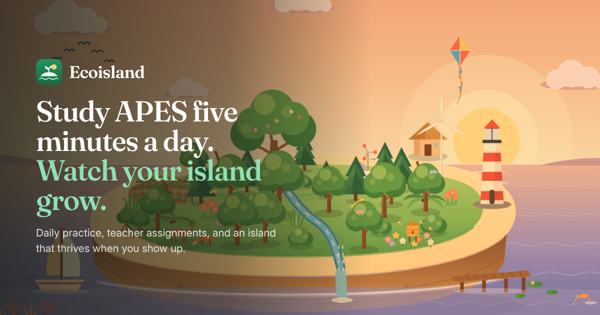

# Ecoisland

**AP Environmental Science, five minutes a day.** Students answer a short daily set built on spaced repetition, finish the work their teacher assigns, and grow an island that thrives when they show up and wilts when they don't.



## How it works

- **Daily set.** Ten questions from the class's current unit, mixed with reviews of anything the student missed before (a Leitner spaced-repetition schedule). It keeps the streak alive and waters the island.
- **The island.** Drawn in SVG from the student's real progress. XP grows plants through six stages, every unit mastered at 70% adds a landmark from that unit, and missed days dry the island out until the next daily set. Treecoins buy skies and decorations.
- **Teachers.** Create a class, share a six-character code, and assign lessons, lesson or unit quizzes, FRQs, daily sets or field quests with due dates. Completion fills in automatically as students do the work. Set the current unit and test date to focus every student's practice.
- **Study.** 9 units, 108 lessons, 1,221 practice questions, 27 FRQs graded part by part against a rubric, flashcards and an exam guide.

Ecoisland is built for laptops, Chromebooks and desktops. Windows narrower than 1024px see a short "needs a bigger screen" page.

## Tech

| Area | Technology |
|---|---|
| App | Vite, React 19, TypeScript, Tailwind CSS v4, framer-motion |
| Effects | Selected [React Bits](https://reactbits.dev) components (see `THIRD_PARTY_NOTICES.md`) |
| Auth & data | Firebase Authentication (Google), Firestore, Storage |
| API | Cloudflare Worker (`worker/`): verifies Firebase ID tokens and makes every write that is worth something |
| AI | Gemini, server-side only, for FRQ grading |
| Hosting | Cloudflare Workers at https://ecoisland.xyz |

### Where things live

- `src/shared/` is shared by the app and the Worker: curriculum, reward economy, island growth, shop catalog, assignment rules.
- `worker/` is the API: rewards, purchases, classes, FRQ grading, account deletion and reminders.
- `firestore.rules` and `storage.rules`: the browser can only change a student's own profile, cosmetic choices and spaced-repetition state. Treecoins, XP, streaks, progress, class membership and submissions are written only by the Worker.
- `src/components/island/` is the island illustration: plants, decorations, landmarks and skies.

## Local development

```bash
pnpm install
cp .env.example .env.local
pnpm dev:emulators   # terminal 1: Firebase emulators (needs Java)
pnpm dev             # terminal 2: app + API on http://localhost:5173
```

`pnpm dev` runs the Worker inside Vite, so `/api/*` works without wrangler. With the emulators you can sign in through the emulator's Google screen, and nothing touches real student data.

## Tests

```bash
pnpm typecheck
pnpm lint
pnpm test            # unit tests: economy, dates, assignments, curriculum, tokens
pnpm test:emulator   # Firestore/Storage rules + Worker API against the emulators
```

## Deploying

The new app needs the Worker to reach Firestore with a service account. **Do steps 1 and 2 before (or right after) deploying the new code**, or the API returns 503 and students see "Can't reach Ecoisland".

1. **Service account.** Firebase console → Project settings → Service accounts → Generate new private key. Then:
   ```bash
   npx wrangler secret put FIREBASE_SERVICE_ACCOUNT < service-account.json
   ```
   Delete the downloaded file afterwards.
2. **Security rules.**
   ```bash
   pnpm deploy:rules
   ```
3. **FRQ grading** (optional, but FRQs can't be graded without it):
   ```bash
   npx wrangler secret put GEMINI_API_KEY
   ```
4. **Streak reminder emails** (optional). Create a [Resend](https://resend.com) key for a verified domain, then:
   ```bash
   npx wrangler secret put RESEND_API_KEY
   ```
   Add `"REMINDER_FROM": "Ecoisland <reminders@ecoisland.xyz>"` to `vars` in `wrangler.jsonc`. The reminder toggle in Settings only appears once both are set. The daily cron is already configured.
5. **Storage CORS** (optional, tightens the bucket to Ecoisland's origins):
   ```bash
   gsutil cors set cors.json gs://ecoisland-b9e34.appspot.com
   ```
6. **Deploy.**
   ```bash
   pnpm deploy
   ```

`GET /api/health` reports whether the server is configured (`configured`, `grading`, `reminders`).

### Existing accounts

The first time an existing student signs in, the server migrates their account once. It refunds every item bought in the old island shop as Treecoins, converts old levels into lifetime XP, and reserves their username. Everyone goes through the new onboarding once to choose student or teacher.

## Browser support

Tested in Chromium (Chrome, Edge, Chromebooks). The code that kept older versions from working in Safari and Firefox has been removed, but those browsers were not part of this round of testing. Tailwind CSS v4 needs Safari 16.4+, Chrome 111+ or Firefox 128+.

## Why Ecoisland?

Many students understand that environmental science matters but few feel personally connected to it. As a high school student, I built Ecoisland around how my generation actually studies: small daily habits, visible progress, and doing it together with our class.

Original demo (2025 Congressional App Challenge): https://www.youtube.com/watch?v=m4QyoFBDeEc
